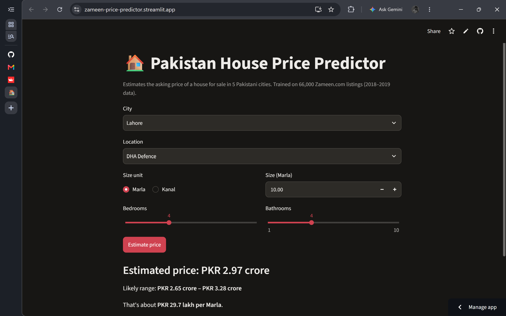
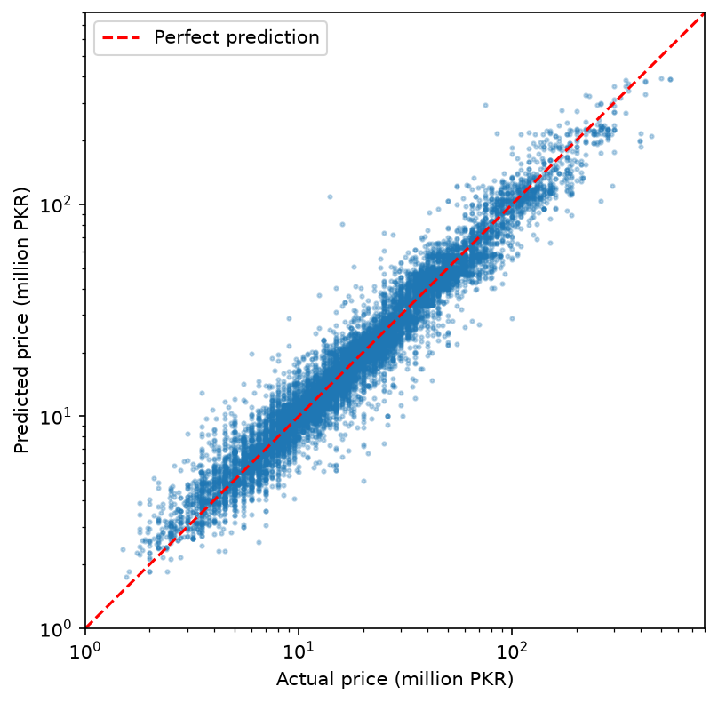
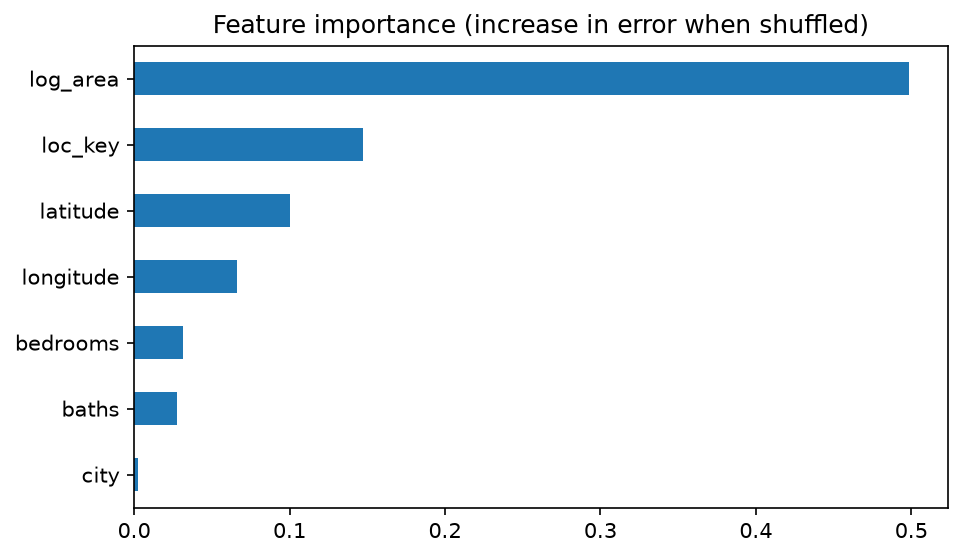

# 🏠 Pakistan House Price Predictor

Predicts the asking price of a house for sale in five Pakistani cities: Lahore, Karachi, Islamabad, Rawalpindi and Faisalabad. It was trained on 66,000 Zameen.com listings.

**🔗 Live demo:** [zameen-price-predictor.streamlit.app](https://zameen-price-predictor.streamlit.app/)



---

## Results

The models were evaluated on a held-out test set of 13,232 houses that were never seen during training.

| Model | Features | Median error | Within ±20% | MAE (PKR) |
|---|---|---|---|---|
| Baseline (city price/Marla × area) | city, area | 23.6% | 44.3% | 9.35M |
| Linear regression | city, area, bedrooms, baths | 23.4% | 43.3% | 8.69M |
| **Gradient boosting** | + location, latitude/longitude | **10.3%** | **76.0%** | **4.43M** |

The final model predicts **3 out of 4 houses within ±20%** of their listed price, with a typical error of about 10%.



---

## Key findings

- **Location is the biggest lever.** Adding the neighbourhood and its coordinates cut the typical error by more than half, from 23.6% to 10.3%. Houses of the same size can differ in price by 10× depending on where they are. For example, Karachi's DHA Defence costs about 5.3M per Marla, compared with about 3.0M in North Karachi.
- **Bedrooms and baths add little once size is known.** Linear regression with room counts barely beats a simple "price per Marla × area" rule.
- **Prices cluster at standard plot sizes** (5, 10, 20 and 40 Marla), which shows how the market is actually built and listed.



---

## Error analysis

**By city**

| City | Test houses | Median error | Within ±20% |
|---|---|---|---|
| Islamabad | 1,770 | 9.5% | 80.2% |
| Karachi | 3,177 | 10.2% | 73.5% |
| Lahore | 6,482 | 10.3% | 77.5% |
| Rawalpindi | 1,468 | 10.6% | 73.9% |
| Faisalabad | 335 | 16.9% | 59.1% |

Faisalabad is the weakest because it has the fewest listings to learn from.

**By price range**

| Price band | Median error | Bias |
|---|---|---|
| Cheapest 20% | 12.6% | +5.1% |
| Low | 8.6% | +0.1% |
| Middle | 8.5% | −1.2% |
| High | 10.7% | −3.3% |
| Top 20% | 11.7% | −4.3% |

The model is most accurate in the mid-market. It slightly overprices the cheapest houses and underprices the most expensive ones. This is a common "regression to the mean" effect.

---

## How it works

1. **Data cleaning** (`notebooks/01_exploration.ipynb`)
   - Kept houses for sale only, dropping rentals, flats and portions.
   - Converted area text ("1 Kanal", "5 Marla") to one numeric unit (Marla, where 1 Kanal = 20 Marla).
   - Removed invalid listings (0 bedrooms or baths, more than 100 Marla) and price-per-Marla outliers (bottom and top 1%).
   - Went from 168,446 raw listings to 66,158 clean houses.
2. **Modelling** (`notebooks/02_modeling.ipynb`)
   - The target is **log(price)**. Prices are heavily skewed, and log makes errors proportional (a 10% miss counts the same for a 1 crore house as for a 10 crore house).
   - **Location encoding:** there are 1,294 unique neighbourhoods, so one-hot encoding isn't practical. Each location is **target-encoded**: it's replaced by its typical price, learned from training data only, using cross-fitting to prevent leakage.
   - **Model:** scikit-learn `HistGradientBoostingRegressor` (500 trees), inside a `Pipeline` so preprocessing is identical at training and prediction time.
   - The final model is retrained on all data after evaluation.
3. **Web app** (`app/app.py`): a Streamlit app where you pick a city, location, size (Marla or Kanal) and rooms. It returns a price estimate, a likely range (±10%) and the price per Marla.

---

## Project structure

```
zameen-price-predictor/
├── app/
│   └── app.py                  # Streamlit web app
├── images/                     # Charts and screenshots for this README
├── models/
│   ├── price_model.joblib      # Trained model pipeline
│   └── locations.csv           # Locations per city with coordinates
├── notebooks/
│   ├── 01_exploration.ipynb    # Cleaning + exploratory analysis
│   └── 02_modeling.ipynb       # Models, evaluation, error analysis
├── data/                       # Not in repo; see "Data" below
├── requirements.txt
└── README.md
```

---

## Run locally

```bash
git clone https://github.com/ahmedgill2005/zameen-price-predictor.git
cd zameen-price-predictor
python -m venv .venv
.venv\Scripts\activate          # Windows  (macOS/Linux: source .venv/bin/activate)
pip install -r requirements.txt
streamlit run app/app.py
```

To re-run the notebooks, also run `pip install jupyter seaborn` and download the data (see below).

---

## Data

"Zameen Property Data" from [opendata.com.pk](https://opendata.com.pk/dataset/property-data-for-pakistan), scraped from Zameen.com. Download the CSV and place it in `data/raw/`. The data isn't included in this repo.

---

## Limitations

- **Old data:** listings are from around 2018–2019. Current prices are higher, so predictions reflect that period, not today's market.
- **Asking prices, not sale prices:** listed prices often differ from what houses actually sell for.
- **Missing plot features:** the dataset has no information on corner plots, main road or park-facing positions, construction year or condition, all of which affect real prices.
- **Neighbourhood-level coordinates:** latitude/longitude point to the area, not the exact house.

## Next steps

- Scrape current listings to measure how prices have changed since 2019.
- Extract features like *corner*, *main boulevard* and *park-facing* from listing titles and descriptions, and measure their price premium.
- Extend to flats and plots.

---

**Author:** Ahmed Nadeem · [GitHub](https://github.com/ahmedgill2005)
